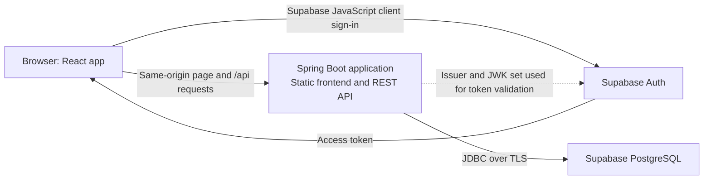

# FindLoop

Misplaced belongings are often hard to recover: reports are scattered across chats and noticeboards, details are easy to miss, and people may have no safe way to contact one another. **FindLoop** brings lost-and-found reports, discovery, explainable match suggestions, and private in-app communication into one application.

FindLoop is a Java and React college project built around a practical idea: a match score should help people find reports worth checking, while clear explanations, privacy boundaries, and an ownership question help people make their own decision. Matching is a heuristic ranking, never proof that an item belongs to a claimant.

## Features

- **Lost and found reports:** Create reports with an item title, description, category, place, event date/time, and optional location details. Lost and found reports are kept distinct so the matcher can compare opposite report types.
- **Explainable match suggestions:** Open reports of the opposite type are ranked using description, location, and event date/time signals. Descriptions use keyword overlap and a small curated synonym set; location uses coordinates when both reports have them and otherwise compares place names. Match cards show component scores and a short explanation.
- **Match scores with limits:** The current score weights location at 45%, description at 40%, and event time at 15%. These are experimental weights, not probabilities. A high score does not prove ownership, and the matcher is not an image model or semantic-embedding system.
- **Search and discovery:** Search reports by text and category, browse lost or found reports, and optionally search nearby when location permission is granted. Nearby search uses report coordinates; exact GPS coordinates are not shown in public report responses.
- **Privacy-conscious contact and messaging:** Users can send contact requests and, after a request is accepted, use in-app conversations rather than posting personal contact details on a report. **Sending contact requests still needs end-to-end validation.**
- **Optional private ownership verification:** A finder can keep an identifying detail private and ask a claimant to answer a question before contact proceeds. The answer is not part of the public report, and the verification step has passed its check. The subsequent contact-request flow still needs end-to-end testing.
- **Report lifecycle and notifications:** Owners can mark reports returned or closed; non-open reports are excluded from open search and match candidates. Users can choose in-app match and reply notification preferences, including off, immediate, and daily roundup. Email and push delivery are not configured.

## Architecture



The browser loads the React application from Spring Boot and calls the API at the same origin under `/api`. Supabase Auth handles sign-in; the API validates access tokens using the configured Supabase issuer and JWK set. Spring Boot connects to Supabase PostgreSQL through JDBC.

The root Dockerfile uses a **multi-stage build**: Node.js and npm install frontend dependencies and Vite builds static assets; Maven packages the Java application with those assets; a Java 25 runtime image serves the frontend and API together. Node.js is part of the frontend development/build toolchain and is not the production backend.

## Technology stack

| Area | Technology | Role in FindLoop |
| --- | --- | --- |
| Frontend | React | Builds the interactive report, search, match, settings, and messaging views in the browser. |
| Frontend tooling | Node.js, npm, Vite | Node.js runs the frontend development/build tools; npm installs packages; Vite provides the development server and creates the production static bundle. Node.js does not serve the production API. |
| Backend | Java 25, Spring Boot 3.5.6 | Implements the REST API and serves the built frontend in the container. |
| Security | Spring Security OAuth2 Resource Server | Protects authenticated operations and validates Supabase-issued bearer JWTs. |
| Data access | Spring Data JPA, Hibernate | Maps Java entities to relational data and performs persistence operations. |
| Database | Supabase PostgreSQL | Stores reports, contact requests, conversations, ownership verifications, and notification data. |
| Authentication | Supabase Auth, `@supabase/supabase-js` | Provides browser sign-in and access tokens used for authenticated API requests. |
| Build tools | Maven, npm | Maven compiles and packages the Spring Boot application; npm installs frontend dependencies and runs Vite scripts. |
| Deployment | Docker multi-stage build | Produces one container for the frontend and backend. Supabase remains an external managed service. No provider-specific hosting configuration is committed; deploy the image to a Docker-capable host. |

## Technical highlights

- Matching uses provisional weights: `0.45 × location + 0.40 × description + 0.15 × event time`.
- When both reports have coordinates, location similarity uses Haversine distance bands. Otherwise, it falls back to normalized place-name overlap. Missing event times receive a neutral score rather than being treated as a mismatch.
- A match result exposes separate description, location, and time scores to help people understand the ranking. Scores are on a 0–100 scale and must not be interpreted as confidence probabilities.
- The backend stores ownership answers as password hashes rather than returning them in report views.
- Report event time is distinct from report creation time, so matching uses when an item was lost or found rather than when someone entered the report.
- A small labeled evaluation set is included at `src/test/resources/matching-evaluation.psv`. It contains only four synthetic lost/found scenarios; the recorded baseline is Recall@3 = 1.00 and mean reciprocal rank (MRR) = 1.00. This tiny, hand-authored set is not an estimate of real-world matching accuracy. Expand it with consented, labeled examples before tuning weights.

## Run locally

### Requirements

- JDK 25 or newer
- Maven 3.9 or newer
- Node.js 22 or newer and npm
- A Supabase project with PostgreSQL and Supabase Auth configured

### Configure the backend

For Docker, copy the root `.env.example` to `.env`. For a direct local Spring Boot run, set the database values and Supabase project URL in the PowerShell session where Maven will run:

```powershell
$env:SUPABASE_DB_URL = "jdbc:postgresql://YOUR_SUPABASE_DB_HOST:5432/postgres?sslmode=require"
$env:SUPABASE_DB_USERNAME = "YOUR_DATABASE_USERNAME"
$env:SUPABASE_DB_PASSWORD = "YOUR_DATABASE_PASSWORD"
$env:SUPABASE_URL = "https://YOUR_PROJECT.supabase.co"
```

Use a plain Supabase project URL for `SUPABASE_URL`. The backend derives the JWT issuer as `${SUPABASE_URL}/auth/v1` and the signing-key endpoint as `${SUPABASE_URL}/auth/v1/.well-known/jwks.json`; use the URL for the same Supabase project as the database and browser client.

### Configure the frontend

Copy `frontend/.env.example` to `frontend/.env.local` and set the following Vite variables:

```dotenv
VITE_API_URL=http://localhost:8080/api
VITE_SUPABASE_URL=https://YOUR_PROJECT.supabase.co
VITE_SUPABASE_PUBLISHABLE_KEY=YOUR_SUPABASE_PUBLISHABLE_KEY
```

These names match the Vite client. The publishable key is intended for browser use; never put a Supabase secret or service-role key in frontend configuration.

### Start the development servers

In one terminal at the repository root:

```powershell
mvn spring-boot:run
```

In another terminal:

```powershell
cd frontend
npm ci
npm run dev
```

Open the Vite URL shown in the terminal, usually `http://localhost:5173`. The Spring Boot API runs at `http://localhost:8080`. On Windows, `start-findloop.bat` starts both development servers in separate terminal windows.

## Run with Docker

The root `Dockerfile` builds the frontend and backend into one image. Supabase remains separate. Copy `.env.example` to `.env` and set these required runtime variables:

```dotenv
SUPABASE_DB_URL=jdbc:postgresql://YOUR_SUPABASE_DB_HOST:5432/postgres?sslmode=require
SUPABASE_DB_USERNAME=YOUR_DATABASE_USERNAME
SUPABASE_DB_PASSWORD=YOUR_DATABASE_PASSWORD
SUPABASE_URL=https://udbkycrpxyzwgootygbj.supabase.co/rest/v1/
SUPABASE_PUBLISHABLE_KEY=YOUR_SUPABASE_PUBLISHABLE_KEY
```

Build and run from the repository root:

```powershell
docker build -t findloop .
docker run --env-file .env -p 8080:8080 findloop
```

Visit `http://localhost:8080`. The container listens on `PORT`, defaulting to `8080`; a hosting platform can supply a different port. The Docker image reads Supabase values at runtime, and `.env` is excluded from the image and should not be committed. `APP_CORS_ALLOWED_ORIGINS` is an optional Spring Security CORS setting, defaulting to `http://localhost:5173`; the report controller also declares its own localhost origins, so this setting alone does not currently enable a separate production frontend origin. Same-origin use does not need a cross-origin browser request.

The repository provides the Docker image, not a configured hosting account or provider-specific deployment file. Choose a Docker-capable host, set the runtime environment variables there, and use the port supplied by that host. Supabase remains the external database and authentication provider.

## Honest limitations

- Matching uses keywords, a small curated synonym set, approximate location signals, and date/time buckets. It does not use semantic embeddings or AI photo matching.
- Location search by radius requires report coordinates. If coordinates are absent, match scoring uses place-name text instead.
- The four-case synthetic evaluation set is too small to support real-world performance claims. Matching scores are rankings, not probabilities or proof of ownership.
- Photos are not currently stored, compared, or used to generate descriptions.
- Notifications are in-app only; email and push delivery are not configured.
- Ownership verification has passed its verification check, but sending a contact request after verification still needs end-to-end validation.
- Hibernate is configured with `ddl-auto=update`. Before real users rely on the service, introduce reviewed database migrations and verify backup and restore procedures.

## Useful commands

Run backend tests, including the synthetic matching evaluation:

```powershell
mvn test
```

Check the frontend lint rules and create a production bundle:

```powershell
cd frontend
npm run lint
npm run build
```

## Project structure

```text
frontend/   React and Vite client
src/        Spring Boot API, matching, notifications, and tests
Dockerfile  Multi-stage image for the frontend and backend
```
