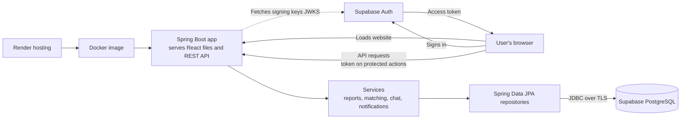

# FindLoop — Lost & Found Platform

FindLoop is a full-stack lost-and-found platform that helps people report misplaced belongings, discover potentially matching reports, and coordinate returns through private in-app communication.

**Built with:** Java 25 · Spring Boot · React · Vite · Supabase PostgreSQL · Supabase Auth · Docker

[**Live Demo**](https://findloop-r8jl.onrender.com/) · [**GitHub Repository**](https://github.com/chins987/FindLoop)

> **Note:** The demo runs on Render. If the service has been idle, the first load may take up to a minute while it wakes up.

<!-- Add screenshots or a short GIF here, e.g. a match card showing its score breakdown:

-->

## Why FindLoop?

Lost-and-found information is often scattered across messages, noticeboards, and informal groups. FindLoop brings reports and discovery into one place and ranks potential matches using explainable description, location, and event-time signals.

Matching scores are heuristic rankings, not probabilities or proof of ownership. See [Status and limitations](#status-and-limitations).

## Features

- **Lost and found reports:** Create reports with a title, description, category, place, event date/time, and optional location details. Lost and found reports are kept distinct so the matcher can compare opposite types.
- **Explainable match suggestions:** Open reports of the opposite type are ranked using description, location, and event date/time. Match cards show component scores and a short explanation.
- **Search and discovery:** Search by text and category, browse lost or found reports, and optionally search nearby when location permission is granted. Exact GPS coordinates are never shown in public report responses.
- **Privacy-conscious contact and messaging:** Contact requests and, once accepted, in-app conversations replace posting personal contact details on a report.
- **Private ownership verification:** A finder can keep an identifying detail private and ask a claimant a question before contact proceeds. The answer is stored as a password hash and never appears in report views.
- **Report lifecycle and notifications:** Owners can mark reports returned or closed; non-open reports are excluded from search and match candidates. Users can set in-app match and reply notifications to off, immediate, or daily roundup.

## How matching works

```
score = 0.45 × location + 0.40 × description + 0.15 × event time
```

Each component is scored 0–100 and exposed separately so people can see why a match ranked where it did. The weights are experimental.

| Signal | Method |
| --- | --- |
| Location | Haversine distance bands when both reports have coordinates; otherwise normalized place-name overlap |
| Description | Keyword overlap plus a small curated synonym set |
| Event time | Time gap between when items were lost/found (not when reports were created); a missing time gets a neutral score rather than counting as a mismatch |

A small synthetic evaluation set is at `src/test/resources/matching-evaluation.psv` (four hand-written scenarios, Recall@3 = 1.00, MRR = 1.00). It is **not** an estimate of real-world accuracy. Expand it with consented, labeled examples before tuning weights.

## Architecture



The browser loads the React app from Spring Boot and calls the API at the same origin under `/api`. Supabase Auth handles sign-in; the API validates bearer tokens using the configured Supabase issuer and JWK set. The app is deployed on Render as a Docker container built with a multi-stage Dockerfile (Vite builds the frontend, Maven packages it with the Java app, and a Java 25 runtime image serves both). Node.js is only part of the build toolchain, not the production backend.

## Technology stack

| Area | Technology |
| --- | --- |
| Frontend | React, Vite, Node.js/npm (build tooling only) |
| Backend | Java 25, Spring Boot 3.5.6 |
| Security | Spring Security OAuth2 Resource Server (Supabase-issued JWTs) |
| Data access | Spring Data JPA, Hibernate |
| API docs | springdoc-openapi 2.8.17, OpenAPI 3, Swagger UI |
| Database and auth | Supabase PostgreSQL, Supabase Auth (`@supabase/supabase-js`) |
| Build | Maven, npm |
| Deployment | Docker on Render (configured in the Render dashboard) |

## Quick start (Docker)

The fastest way to run the packaged app locally.

**Requirements:** Docker Desktop (with Docker Compose) and a Supabase project with PostgreSQL and Supabase Auth.

1. Copy `.env.example` to `.env` and fill in:

   ```dotenv
   SUPABASE_DB_URL=jdbc:postgresql://YOUR_SESSION_POOLER_HOST:5432/postgres?sslmode=require
   SUPABASE_DB_USERNAME=postgres.YOUR_PROJECT_REF
   SUPABASE_DB_PASSWORD=YOUR_DATABASE_PASSWORD
   SUPABASE_URL=https://YOUR_PROJECT.supabase.co
   SUPABASE_PUBLISHABLE_KEY=YOUR_SUPABASE_PUBLISHABLE_KEY
   ```

   In Supabase, open **Connect** and choose **Session pooler** for the host and username. Keep the password in its own variable, and use the JDBC form above rather than the full `postgresql://...` string.

2. Build and run:

   ```bash
   docker compose up --build
   ```

3. Visit <http://localhost:8080>. Stop with `Ctrl+C`; run `docker compose down` to remove the container.

`.env` is excluded from the image and must not be committed. The Render deployment gets its variables from the Render dashboard.

## Run for development

**Requirements:** JDK 25+, Maven 3.9+, Node.js 22+ with npm, and a Supabase project.

### 1. Configure the backend

macOS / Linux (bash/zsh):

```bash
export SUPABASE_DB_URL="jdbc:postgresql://YOUR_SUPABASE_DB_HOST:5432/postgres?sslmode=require"
export SUPABASE_DB_USERNAME="YOUR_DATABASE_USERNAME"
export SUPABASE_DB_PASSWORD="YOUR_DATABASE_PASSWORD"
export SUPABASE_URL="https://YOUR_PROJECT.supabase.co"
```

Windows (PowerShell):

```powershell
$env:SUPABASE_DB_URL = "jdbc:postgresql://YOUR_SUPABASE_DB_HOST:5432/postgres?sslmode=require"
$env:SUPABASE_DB_USERNAME = "YOUR_DATABASE_USERNAME"
$env:SUPABASE_DB_PASSWORD = "YOUR_DATABASE_PASSWORD"
$env:SUPABASE_URL = "https://YOUR_PROJECT.supabase.co"
```

Use the plain Supabase project URL. The backend derives the JWT issuer as `${SUPABASE_URL}/auth/v1` and the signing keys from `${SUPABASE_URL}/auth/v1/.well-known/jwks.json`, so it must be the same project as the database and browser client.

### 2. Configure the frontend

Copy `frontend/.env.example` to `frontend/.env.local`:

```dotenv
VITE_API_URL=http://localhost:8080/api
VITE_SUPABASE_URL=https://YOUR_PROJECT.supabase.co
VITE_SUPABASE_PUBLISHABLE_KEY=YOUR_SUPABASE_PUBLISHABLE_KEY
```

The publishable key is meant for browser use. Never put a Supabase secret or service-role key in frontend configuration.

### 3. Start both servers

Terminal 1 (repository root):

```bash
mvn spring-boot:run
```

Terminal 2:

```bash
cd frontend
npm ci
npm run dev
```

Open the Vite URL shown in the terminal (usually <http://localhost:5173>). The API runs at <http://localhost:8080>. On Windows, `start-findloop.bat` launches both servers in separate windows.

## API documentation

With the backend running, open Swagger UI at <http://localhost:8080/swagger-ui/index.html>; the OpenAPI document is at <http://localhost:8080/v3/api-docs>. Public report reads need no token. For protected operations, click **Authorize** and enter a Supabase access token as a bearer credential.

## Testing and quality checks

```bash
mvn test                  # backend tests, including matching evaluation and edge cases
cd frontend
npm run lint              # frontend lint rules
npm run build             # production bundle
```

`HybridMatchingServiceTest` covers null/blank descriptions, missing event times, missing or invalid coordinates, geographic band boundaries, opposite-type/open candidate filtering, source-report exclusion, ranking, and the ten-result limit.

## Status and limitations

| Area | Status |
| --- | --- |
| Reports, search, nearby search | Implemented |
| Explainable matching | Implemented (heuristic; tiny synthetic evaluation set) |
| Supabase sign-in and protected API | Implemented |
| Ownership verification check | Implemented and passing its check |
| Contact request after verification | **Needs end-to-end validation** |
| In-app notifications | Implemented |
| Email and push notifications | Not configured |
| Photo storage or matching | Not implemented |
| Database migrations | Not yet; Hibernate uses `ddl-auto=update` |

- Matching uses keywords, a small synonym set, approximate location, and time buckets. It does not use semantic embeddings or image matching.
- Radius search requires report coordinates; without them, scoring falls back to place-name text.
- Scores are rankings, not probabilities or proof of ownership.
- Before real users rely on the service, introduce reviewed database migrations (Flyway or Liquibase) and verify backup and restore procedures.
- `APP_CORS_ALLOWED_ORIGINS` (default `http://localhost:5173`) configures Spring Security CORS, but the report controller also declares its own localhost origins, so this setting alone does not enable a separate production frontend origin. Same-origin use needs no CORS.

## Roadmap

- Enable Row Level Security on all Supabase tables so the browser's publishable key cannot reach them through the Data API
- Switch to Flyway/Liquibase migrations with `ddl-auto=validate`
- Normalize ownership answers (trim, lowercase) before hashing, and add attempt limits
- Rate limiting on verification, contact requests, and messaging
- Use category in match scoring
- GitHub Actions CI, Dependabot, health endpoint, and a committed `render.yaml`
- Integration tests with Testcontainers and security tests for 401/403 on protected endpoints
- Grow the labeled evaluation set to 20–30 consented, varied cases

## Project structure

```text
frontend/      React and Vite client
src/           Spring Boot API, matching, notifications, and tests
Dockerfile     Multi-stage image for the frontend and backend
compose.yaml   Local Docker Compose configuration
```
